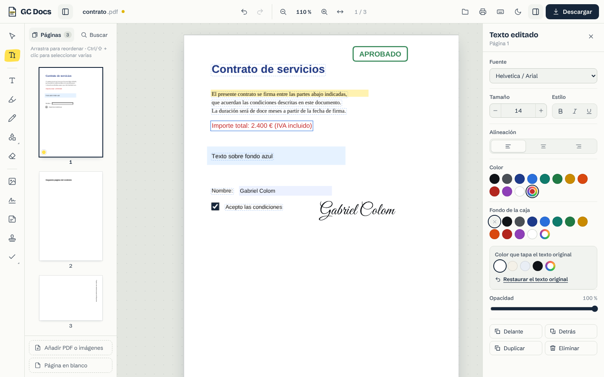
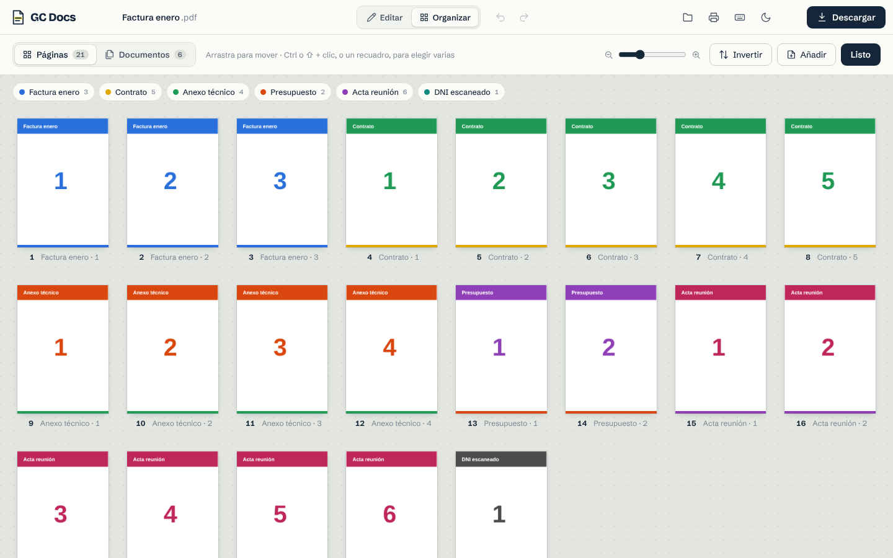

# GC Docs · Editor de PDF

Editor de PDF completo que funciona en el navegador. Abre un PDF, cambia su texto, fírmalo, rellena sus campos, ordena sus páginas y descárgalo. **Todo se procesa en tu equipo**: los archivos nunca se suben a ningún servidor.

**Demo:** https://bielcolom.github.io/gc-docs/





## Funcionalidades

### Editar
- **Editar el texto original del PDF.** Con la herramienta «Editar texto» (`E`) los textos del documento aparecen recuadrados; haz clic en uno y reescríbelo. Se conserva la posición, el tamaño y el color, y se detecta la fuente más parecida (Helvetica/Arial, Times o Courier, con negrita y cursiva).
- **Añadir texto** con 9 fuentes (clásicas, modernas y manuscritas), tamaño, negrita, cursiva, subrayado, alineación, color y fondo. Admite cualquier carácter Unicode (ñ, tildes, Ł, Ž…).
- **Tapar** zonas como con un corrector, para escribir encima.

### Anotar
- Resaltar, subrayar y tachar.
- Dibujo a mano alzada.
- Rectángulos, elipses, líneas y flechas, con borde, relleno, grosor y opacidad.
- Comentarios (se guardan como notas estándar de PDF, visibles en cualquier lector).
- Sellos (APROBADO, PAGADO, CONFIDENCIAL… o uno propio).
- Marcas ✓ ✗ • para formularios impresos.
- Imágenes: desde archivo, arrastrándolas a la página o pegándolas con `Ctrl+V`.

### Firmar y rellenar
- **Firma** dibujada, escrita con tipografía manuscrita o subida desde una foto (con eliminación automática del fondo blanco). Las firmas se recuerdan para la próxima vez.
- **Formularios PDF:** los campos de texto, casillas, botones de opción y desplegables se vuelven editables.

### Organizar páginas y documentos
- **Vista «Organizar»** (`G`) a pantalla completa con todas las páginas en cuadrícula y tamaño de miniatura ajustable.
- Arrastrar y soltar una o muchas páginas a la vez, con desplazamiento automático y animación del cambio de orden. En móvil se arrastra desde el asa de cada miniatura.
- Selección múltiple con `Ctrl`/`⇧` + clic, con un recuadro de selección o con `Ctrl+A`.
- Mover la selección una posición (`Alt` + flechas), al principio, al final o a una posición concreta.
- Cada PDF de origen tiene un color, y su nombre aparece bajo cada página para no perderse al unir muchos archivos.
- **Modo «Documentos»:** reordena PDFs enteros arrastrándolos, ordénalos por nombre (A → Z / Z → A), gíralos o quítalos de una vez.
- En el editor, el panel lateral también permite reordenar arrastrando las miniaturas.
- Girar, duplicar y eliminar páginas, o girar todas a la vez.
- Insertar páginas en blanco, otros PDFs o imágenes en cualquier posición.
- **Unir** varios PDFs e imágenes en uno.
- **Dividir** por rangos (`1-3, 4, 5-8`), cada N páginas o una por archivo (se descarga un ZIP).
- **Extraer** las páginas seleccionadas a un PDF nuevo.
- Invertir el orden.

### Acabado y exportación
- Marca de agua en todas las páginas (texto, tamaño, color, opacidad e inclinación).
- Numeración de páginas con varios formatos y posiciones.
- Propiedades del documento: título, autor, asunto y palabras clave.
- Descargar el PDF, guardarlo como imágenes PNG (72, 150 o 300 ppp) o imprimirlo.
- Abre PDFs protegidos con contraseña.

### Comodidad
- Deshacer y rehacer ilimitado (`Ctrl+Z` / `Ctrl+⇧+Z`).
- Búsqueda de texto sin distinguir mayúsculas ni tildes (`Ctrl+F`).
- Zoom con `Ctrl` + rueda, ajuste al ancho o a la página.
- Tema claro y oscuro, diseño adaptado a móvil y tableta.
- Atajos de teclado para todas las herramientas (pulsa `?` para verlos).

## Cómo funciona la edición de texto

Un PDF no guarda párrafos sino glifos colocados en coordenadas exactas, así que «editar texto» significa:

1. [pdf.js](https://mozilla.github.io/pdf.js/) extrae los fragmentos de texto con su posición, tamaño y fuente, y GC Docs los agrupa en líneas.
2. Al hacer clic en una línea, se muestrea el color del texto y del fondo directamente de los píxeles renderizados.
3. Al exportar, [pdf-lib](https://pdf-lib.js.org/) tapa la línea original con el color de fondo y escribe el texto nuevo en la misma línea base, con la fuente estándar equivalente (o una fuente Unicode incrustada si hace falta).

Es el mismo enfoque que usan la mayoría de editores web. El texto original sigue dentro del PDF debajo del parche, así que no sirve para ocultar información sensible.

## Tecnología

- **[Angular 22](https://angular.dev)** con componentes *standalone*, **signals** y sin Zone.js.
- **pdf.js** para mostrar las páginas, extraer texto y leer formularios.
- **pdf-lib** + **fontkit** para escribir el PDF final.
- **JSZip** para descargar varios archivos a la vez.
- Fuentes incluidas en el proyecto (Roboto, Lora, Roboto Mono, Dancing Script, Great Vibes, Caveat, Bricolage Grotesque y Schibsted Grotesk): la app no depende de servicios externos.

## Estructura del proyecto

```
src/app/
├── app.ts / .html / .css      Estructura general, barra superior y atajos de teclado
├── core/                      Lógica sin interfaz
│   ├── models.ts              Tipos: páginas, anotaciones, ajustes del documento
│   ├── document.store.ts      Estado con signals + historial de deshacer/rehacer
│   ├── pdfjs.ts               Carga de PDFs con pdf.js
│   ├── text-extract.ts        Extracción del texto en líneas editables
│   ├── exporter.ts            Generación del PDF final con pdf-lib
│   ├── export-tools.ts        Dividir, imágenes PNG e impresión
│   ├── fonts.ts               Catálogo de fuentes y métricas
│   └── actions.ts / util.ts   Utilidades compartidas
└── ui/                        Componentes
    ├── welcome                Pantalla de inicio
    ├── viewer / page-view     Visor y capa interactiva de cada página
    ├── tool-rail              Barra de herramientas
    ├── sidebar / thumb        Miniaturas y búsqueda
    ├── inspector              Panel de propiedades
    ├── organizer              Vista de organización en cuadrícula
    ├── dialogs                Firma, sellos, marca de agua, numeración, dividir…
    └── signature-pad          Lienzo de firma
```

Todas las anotaciones se guardan en el «espacio base» de cada página (puntos PDF, origen arriba a la izquierda). Al exportar se convierten al sistema de coordenadas del PDF con la matriz de transformación de pdf.js, lo que permite que funcionen igual en páginas giradas.

## Desarrollo

Necesitas Node.js 20.19 o superior.

```bash
npm install
npm start          # servidor de desarrollo en http://localhost:4200
npm run build      # compilación de producción en dist/gc-docs/browser
```

## Publicación

Cada `push` a `main` compila la app y la publica en GitHub Pages mediante el flujo `.github/workflows/deploy.yml`.

## Licencia

[MIT](LICENSE) © Gabriel Colom
